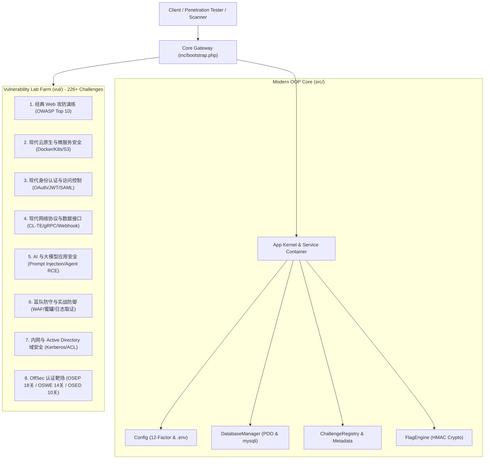

<p align="center">
  
  
  
  
  
  
  
</p>

<h1 align="center">⚡ Pikachu-Enhanced v3.0 (Enterprise Cyber Range)</h1>

<p align="center">
  <b>全技术栈·现代化·综合型网络安全与红蓝对抗靶标实战演练平台</b><br>
  涵盖 OWASP Top 10、云原生微服务、现代身份认证、新型协议利用、AI 大模型安全、内网域控渗透以及 OffSec (OSEP / OSWE / OSED) 认证进阶演练。
</p>

> “如果你想搞懂一个漏洞，最好的方法是：先自己制造出这个漏洞，再利用它，最后再防御它。”

---

## 🌟 v3.0 现代化架构核心亮点 (What's New in v3.0)

Pikachu-Enhanced v3.0 进行了彻底的现代化工程治理重构，全面落地**双引擎架构 (Dual-Engine Architecture)**：

* 🚀 **现代面向对象核心 (`src/`)**：基于 **PSR-4** 命名空间标准（`Pikachu\`），配备零依赖原生回退装载器，与 Composer 无缝融合；
* ⚙️ **12-Factor 配置系统**：完全解耦硬编码，全面支持 `.env` 环境变量驱动，实现应用、数据源与网络端口的灵活编排；
* 🗄️ **双轨数据库数据访问层 (DAL)**：现代化 PDO 预编译引擎保障平台自身安全，配套传统 mysqli 桥梁 100% 保持脆弱 SQL 实验场景的真实度；
* 📜 **挑战契约与集中注册表 (Challenge Contract)**：通过 `ChallengeInterface` 与 `ChallengeRegistry` 规范靶标元数据、难度、分值与解法；
* 🔐 **密码学动态 Flag 引擎 (FlagEngine)**：基于 HMAC-SHA256 动态生成用户专属 Flag，防止抄袭，支持 CTF 竞技模式；
* 🐳 **零接触自动化容器编排 (Zero-Touch Boot)**：内置 `docker/mysql/init.sql`，容器启动即就绪，告别手动安装流程；
* 🎨 **设计系统深度统一**：侧边栏扩展至 272px 黄金排版宽度，消灭长标题单字折行与 Ace 祖传伪元素噪点，全站 226+ 路由 0 死链保证；
* 🧪 **企业级测试与 CI/CD**：配套 PHP 原生测试、跨平台宿主机审计器（`test_runner.py`）以及完整的 GitHub Actions 持续集成流水线。

---

## 🏛️ 系统架构全景图 (Architecture Overview)



---

## 🗺️ 漏洞演练靶标矩阵 (226+ Challenges / 47 Categories)

| 核心领域 | 重点靶标分类与利用链 | 关卡数量 |
| :--- | :--- | :--- |
| **🏛️ 经典 Web 攻防** | SQL 注入 (报错/盲注/宽字节/堆叠)、XSS (反射/存储/DOM/盲打)、CSRF、文件上传 (MIME/图片马/ZipSlip)、文件包含 (LFI/RFI/伪协议)、RCE 命令执行、水平/垂直越权 (BOLA)、任意文件下载、目录遍历、敏感信息泄露 | 80+ |
| **☁️ 云原生微服务** | Docker Socket 逃逸、Privileged 特权模式逃逸、K8s ServiceAccount 令牌接管、S3/OSS 存储桶未授权盲取、Serverless 环境变量泄露 | 15+ |
| **🔑 现代身份认证** | OAuth 2.0 隐式授权与 State 伪造、SAML 2.0 签名包装攻击 (XSW)、JWT 弱口令/None 算法/RS256 混淆、MFA 多因素竞争条件绕过 | 20+ |
| **🌐 新型数据协议** | HTTP 请求走私 (CL-TE / TE-CL)、gRPC 反射与未授权调用、Webhook SSRF 内网穿透、WebSocket 跨站劫持 (CSWSH)、NoSQL 盲注、GraphQL Schema 递归爆破 | 25+ |
| **🤖 AI 与大模型安全** | Prompt Injection 提示词注入越狱、大模型 XSS 渲染攻击、AI Agent 外部工具执行 RCE、系统提示词与模型权重数据提取 | 10+ |
| **🛡️ 蓝队主动防御** | 动态 WAF 规则绕过分析、运行时 RASP 字节码防护对抗、动态高仿真蜜罐指纹识别、全流量告警取证研判 | 10+ |
| **🌐 内网与 AD 域安全** | Kerberos AS-REP Roasting、Kerberoasting、黄金/白银票据伪造、Pass-the-Hash / Overpass-the-Hash、AD ACL 委派攻击链 | 15+ |
| **🎯 OSEP 红队评估** | Win32 API 内存免杀、Office VBA 宏武器化、进程注入与进程镂空、AMSI/UAC 绕过、AppLocker 逃逸、DNS 隐蔽隧道、MSSQL 链接服务器提权、Linux 后渗透 | 18 关 |
| **🔍 OSWE 白盒审计** | 数据流污点分析、认证绕过逻辑链、Java/PHP 反序列化 POP 链、Jinja2 SSTI 沙箱逃逸、XXE OOB 带外提取、布尔盲注自动化脚本、JS 原型链污染、.NET ViewState 利用 | 14 关 |
| **🔬 OSED 漏洞逆向** | x86 汇编自定义 PIC Shellcode 编写、PEB 动态定位 kernel32、格式化字符串读写原语、应用协议逆向 Fuzzing、WriteProcessMemory DEP+ASLR 联合绕过 | 10 关 |

---

## ⚡ 极速启动与部署指南 (Quick Start)

### 选项 A：Docker Compose 容器化一键启动 (推荐)

```bash
# 1. 克隆代码仓库
git clone https://github.com/IKUN-PEPE/Pikachu-Enhanced.git
cd Pikachu-Enhanced

# 2. 从模板复制环境变量配置
cp .env.example .env

# 3. 启动全套微服务编排
docker compose up -d

# 4. 访问靶场
浏览器打开: http://localhost:8765
```
*数据库已通过 `docker/mysql/init.sql` 自动初始化完毕，开箱即可演练！*

### 选项 B：原生环境部署 (PHP + MySQL)
1. 确保安装了 PHP 8.0+（开启 `mysqli`, `pdo_mysql`, `curl`, `mbstring`, `gd` 扩展）；
2. 复制 `.env.example` 为 `.env`，修改其中的数据库连接信息；
3. 将项目目录挂载至 Web 服务器（如 Nginx 或 Apache）；
4. 访问 `http://localhost/install.php` 执行一键数据库就绪诊断。

---

## 🧪 现代化研发质量保证 (Developer QA & Testing)

开发过程中可随时运行内置的企业级质量门禁：

```bash
# 1. 运行跨平台综合质量审计套件 (支持任意环境)
python test_runner.py

# 2. 运行 PHP 原生测试套件
php tests/run_tests.php

# 3. 执行 PSR-12 代码风格检查
composer phpcs

# 4. 执行 PHPStan 静态分析
composer phpstan
```

---

## 📖 深入文档与规范 (Documentation)

* 📐 [**系统架构设计规范 (ARCHITECTURE.md)**](file:///C:/Users/Administrator/VScode/Pikachu-Enhanced/ARCHITECTURE.md)：双引擎设计哲学、组件交互及安全模型；
* 🤝 [**开发者贡献指南 (CONTRIBUTING.md)**](file:///C:/Users/Administrator/VScode/Pikachu-Enhanced/CONTRIBUTING.md)：5 分钟新增关卡、PSR-12 规范、PR 审查标准；
* 📝 [**版本更新日志 (CHANGELOG.md)**](file:///C:/Users/Administrator/VScode/Pikachu-Enhanced/CHANGELOG.md)：v3.0.0 完整重构里程碑。

---

## ⚠️ 免责声明 (Disclaimer)

本项目仅供网络安全技术爱好者、企事业单位信息安全技术人员、高校网络空间安全专业师生进行**合法、合规的技术教学与实战防御研究**。  
使用者不得将本平台包含的漏洞原理、利用技术或演示载荷用于任何未经书面授权的真实生产系统或网络攻击行为。因擅自违规使用本工具而导致的任何直接或间接法律责任均由使用者自行承担，与本项目作者及贡献者无关。
